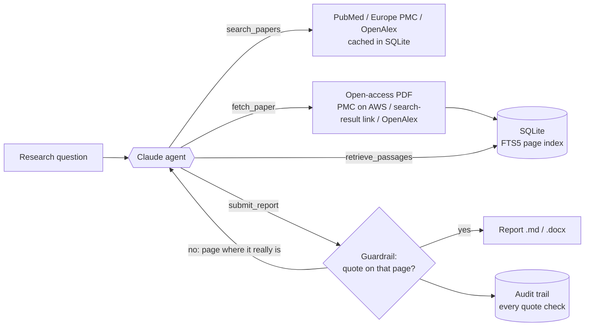

# Verified Literature Review Agent

**An AI agent that answers a research question in any field (medicine, education, social sciences, ...) with a short literature review, where every quote is machine-checked against the exact PDF page it cites.** Agentic RAG with Claude, SQLite full-text retrieval, a code-level anti-hallucination guardrail and an audit trail, exposed as a CLI, a web UI and a REST API.

[](https://github.com/sharon0r/verified-lit-review/actions/workflows/tests.yml)


> **בקצרה:** בניתי ב-Python סוכן AI לשלב הראשון של מחקר: איתור מאמרים וסקירת ספרות. נותנים לו שאלת מחקר ומספר מאמרים. הסוכן (Claude) מחפש מאמרים בגישה פתוחה מכל תחום, מרפואה ועד חינוך, מוריד אותם, שומר כל עמוד במסד נתונים SQLite, שולף את העמודים הרלוונטיים וכותב סיכום עם ציטוטים (RAG). לפני שציטוט נכנס לדו"ח, הקוד מוודא שהוא מופיע מילה במילה ומספר במספר בעמוד שצוין. ציטוט שגוי חוזר לסוכן לתיקון, וכל בדיקה נשמרת במסד הנתונים לתיעוד. אפשר להריץ את הכלי משורת הפקודה, מממשק בדפדפן או דרך API.

---

## Why

Language models are good at summarizing research and bad at citing it: quotes that sound right but are slightly altered, or a real sentence attached to the wrong page. In a hospital that is a patient-safety problem, not a style problem. Here the model may *propose* quotes, but only code decides what reaches the report.

## How it works



1. **Agent.** Claude splits the question into sub-topics, picks the database (PubMed for recent systematic reviews and meta-analyses on health questions, Europe PMC for medicine and life sciences, OpenAlex for every other field), writes English search queries (also for Hebrew questions), reads abstracts and picks papers. If a PDF cannot be downloaded it chooses another paper.
2. **Retrieval.** Each PDF page is stored in a SQLite FTS5 table; the agent reads only the pages that BM25 ranks as relevant.
3. **Generation.** Findings, caveats and 1-3 exact quotes per paper, with page numbers.
4. **Guardrail.** Every quote is normalized and must appear on the cited page. Failures go back to the agent once, with the page where the sentence really is; the final report is re-checked against the PDFs and keeps verified quotes only.
5. **Audit trail.** Every quote check, the model, the PDF's SHA-256 and the run cost are stored in SQLite.

### The guardrail

| Ignored (layout noise) | Kept (meaning) |
|---|---|
| case, spaces, line breaks, hyphenation, punctuation, ligatures (`fi` → `fi`), dash variants | every word in any script, every digit, the decimal point (`1.1` ≠ `11`), minus signs, `<` `>` `≤` `≥` `%`, the page number |

`p>0.05` instead of `p<0.05`, one changed number, or a correct sentence on the wrong page are all rejected. Quotes shorter than 20 normalized characters are rejected as too unspecific to prove anything.

**A second guardrail for numbers.** Findings are the model's own words, so they cannot be matched as text - but the numbers in them can. Every number in a paper's findings (effect sizes, confidence limits, percentages, sample sizes) is looked up among the numbers printed in that paper; a rounded value counts (0.72 for a printed 0.719). Every number in the conclusion must appear in a verified finding or quote, so a number cannot pass just because it happens to be printed somewhere in some paper. Numbers that are not found go back to the agent like rejected quotes, and any that remain are marked ⚠️ in the report. In a heart-failure run, 94 of 94 numbers were found ([report](examples/heart-failure-rehab/Research_Summary_Report.md); that run predates the stricter conclusion rule, which was added after a reviewer found that conclusion numbers could pass by chance - see [EVALUATION.md](EVALUATION.md)). Not checked: wording, context, and the sign of a value.

## Example run

Question: *Does telephone follow-up after hospital discharge reduce readmissions?* ([full log](examples/telephone-follow-up/run_log.txt) · [report, Hebrew](examples/telephone-follow-up/Research_Summary_Report.md)). Abridged log; the full run took about 6 minutes:

```text
🔍 [europepmc] 'telephone follow-up after hospital discharge readmission systematic review meta-analysis': 1 papers
🔍 [europepmc] 'post-discharge telephone call readmission randomized': 4 papers
🔍 [openalex] 'telephone follow-up discharge readmissions': 10 papers
⬇  10.1093/ageing/afaa002: ok, 12 pages
⬇  10.1089/pop.2009.0076: failed            (no open PDF -> the agent picks another paper)
⬇  10.1186/s12913-021-06156-2: ok, 12 pages
✅ submission 1: 7/7 quotes verified
💲 74,232 input (50,035 from cache) + 5,011 output tokens ≈ $0.24
```

The report states the question as **PICO**, says plainly that it is a rapid look at three open-access papers and not a systematic review, opens with a cautious **conclusion** (telephone follow-up may moderately reduce readmissions, mostly as part of multi-component programmes; results are inconsistent) and rates the **certainty of evidence as low, GRADE-style**, with a reason for each downgrade. Each paper states **why it was chosen** and **where it came from**; indirect evidence is flagged as such, and "5 of 10 studies effective" comes with the note that two showed the effect only in one subgroup.

A second run, on an education question (*Does formative assessment with feedback improve student achievement?*): the agent chose OpenAlex on its own and verified 6/6 quotes for $0.27 ([report](examples/formative-assessment/Research_Summary_Report.md)).

## Evaluation

Every run checks quotes and numbers in code. In addition, after each change a report was reviewed by **AI reviewer agents** (LLM-as-judge: a separate Claude agent instructed to review as a physician-researcher or a clinical psychologist; not human experts):

| Round | Main change | Score |
|---|---|---|
| 1 | baseline | 6 / 10 (physician agent), 6 / 10 (psychologist agent) |
| 2 | reporting rules for statistics and certainty | 7 / 10, 7 / 10 |
| 3 | PubMed search for recent systematic reviews | 8.5 / 10 |
| 4 | number guardrail, absolute effects | 9 / 10 |

Method, findings per round, open issues and the limits of this evaluation: [EVALUATION.md](EVALUATION.md).

## Run it

```bash
pip install -r requirements.txt
export ANTHROPIC_API_KEY=...          # never commit it; .env and *.db are git-ignored

python -m verified_lit_review "Does telephone follow-up after discharge reduce readmissions?" --n 3   # CLI
streamlit run app.py                                                                                 # web UI
uvicorn verified_lit_review.api:app --app-dir src                                                    # REST API, docs at /docs
```

(On Windows PowerShell use `$env:ANTHROPIC_API_KEY = "..."`; for the CLI and API set `PYTHONPATH=src` or `pip install -e .`.)

**Cloud (Streamlit Community Cloud).** Deploy `app.py` from this repo and paste the keys from [`.streamlit/secrets.toml.example`](.streamlit/secrets.toml.example) into the app's *Secrets*. The key never enters the repository. Because every run is paid for with the owner's API key, the hosted app gives each visitor one trial run (`RUNS_PER_VISITOR`, or an `APP_PASSWORD` instead), shows saved example reports for free, and enforces a `DAILY_RUN_LIMIT` (default 10 per 24 h) and `MAX_PAPERS` (default 5). The per-visitor limit lives in the browser session and the daily counter in a local SQLite file, so neither is a hard guarantee (a refresh or an app restart resets them); the hard ceiling is the prepaid API credit, with auto-reload off.

REST API:

| Method | Path | |
|---|---|---|
| `POST` | `/reviews` | `{"question": "...", "n_papers": 3, "language": "he"}` → report Markdown, verified and rejected quotes, cost |
| `GET` | `/runs` | recent runs with verification counts |
| `GET` | `/runs/{id}` | one run with its full audit trail |

## Design decisions

- **Three open databases, chosen per question.** PubMed (restricted to systematic reviews and meta-analyses from the last 10 years, with free full text) so the newest syntheses are not missed; Europe PMC for biomedicine; OpenAlex for every discipline. The agent decides, and falls back to another when results are thin.
- **Journal sources, filtered in code where the APIs allow it.** OpenAlex: journal articles and reviews, not retracted, in CWTS "core" journals (leaves out marginal and predatory venues). Europe PMC: no preprints, no retracted publications. PubMed: systematic reviews and meta-analyses, not retracted. These filters do not exclude every editorial or letter, so the prompt also tells the agent to reject non-research items; that part is the model's judgement, not a guarantee.
- **Prompt caching.** Each agent turn re-sends the conversation; caching the prefix cut one run from $0.83 to $0.31.
- **Defence in depth for a public demo.** Password with attempt limit, daily run limit, a per-run cost cap (`MAX_COST_PER_RUN`, default $1), question length limit, the API off unless `API_TOKEN` is set, PDF downloads refused for private/internal addresses (SSRF) and capped at 40 MB while streaming, and document text passed to the model labelled as untrusted data (prompt-injection hygiene).
- **Official APIs only, politely.** No scraping. An honest User-Agent, at most one request per second per host, exponential back-off that honours `Retry-After`, and a SQLite cache, so a repeated question makes no network calls and still works offline.
- **A manual tool-use loop** instead of a framework, so every step is visible, testable and logged.
- **The guardrail lives in code, not in the prompt.** The prompt asks for exact quotes; the code checks them.
- **Tests never call the model.** A scripted fake model drives the agent loop, so CI is free and deterministic.

## Project structure

```text
src/verified_lit_review/
  agent.py              Claude tool-use loop, guardrail feedback, cost tracking
  prompts/agent_system.md  the execution prompt (kept separate from code)
  db.py                 SQLite: search cache, papers, FTS5 page index, runs, quote_checks
  sources.py            polite PubMed, Europe PMC and OpenAlex clients (rate limit, back-off, offline cache)
  fetch.py              open-access PDF download (PMC on AWS, search-result link, OpenAlex) + page indexing
  build_report.py       quote normalization + verified Markdown report
  numbers.py            number guardrail: numbers in findings must appear in the paper
  service.py            shared entry point for the web UI and the API (input checks, run folders)
  api.py                FastAPI REST API
  md_to_docx.py         Markdown → Word, right-to-left Hebrew aware
app.py                  Streamlit web UI (Hebrew, right-to-left)
tests/                  78 tests: guardrail, store, sources, fetch, agent loop, API, Word export
```

## Tests

```bash
python -m pytest
```

No API key or network is needed: PDFs are generated on the fly, HTTP is faked, and the agent runs against a scripted model. The agent tests cover a misattributed quote being sent back and fixed, an altered number being dropped, and reading before fetching being refused.

## Lessons learned

- **Normalization is a safety decision.** A first version stripped everything except Latin letters and digits, so `p<0.05` matched `p>0.05` and Hebrew quotes could never verify. A code review caught it.
- **Read the API's real behaviour.** Europe PMC answers `sort=RELEVANCE` with HTTP 503, which looked like an outage; the default order is already relevance.
- **Verification must be per page**, not per document, or a correct sentence with a wrong page number passes.
- **Review your own work adversarially.** Three review passes (QA, security, interviewer) found real bugs: two DOIs mapping to one file name, a failed PMC lookup skipping the other download routes, a re-indexed paper losing its PMCID, and an API with no authentication. All fixed with tests.
- **Publisher sites block scripts even for open papers.** The PMC open-data bucket on AWS is the reliable route.

## Limitations

- Only quotes are verified mechanically. Findings and paper choice still need expert review; the report states each paper's limits.
- Open-access papers only; scanned PDFs without a text layer are skipped (no OCR).
- In a hospital deployment the model would run under the organization's data agreements, and no patient data should ever be sent. This tool only handles published papers.

## How it was built

Designed and built with [Claude Code](https://claude.com/claude-code) as an AI pair programmer. The requirements, the guardrail design, the choice of sources and the review of every output were mine.

## Contact

**Sharon Weissberg** · [LinkedIn](https://www.linkedin.com/in/sharon-weissberg-82596911) · [sharonor.we@gmail.com](mailto:sharonor.we@gmail.com)

## License

© 2026 sharon0r. **All rights reserved.** Shared for viewing and evaluation only; using, copying or modifying the code requires written permission. See [LICENSE](LICENSE). The example report quotes short passages from open-access articles for scholarly purposes; each article remains under its original license.
