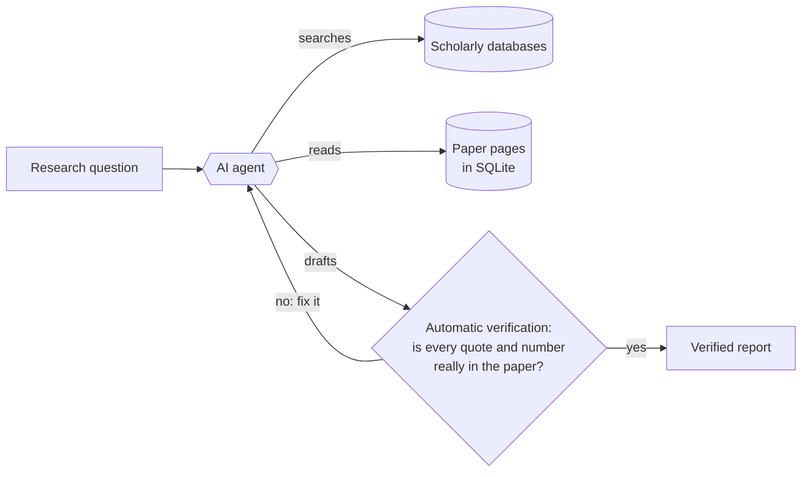

# Verified Literature Review Agent

**Ask a research question. An AI agent finds open-access papers, reads them, and writes a short
literature review in which every quote and every number is checked by code against the original paper.**

> **בקצרה:** בניתי סוכן AI שמבצע את השלב הראשון של מחקר: איתור מאמרים וסקירת ספרות. מזינים שאלת
> מחקר, והסוכן מחפש מאמרים אקדמיים בגישה פתוחה, קורא אותם וכותב סקירה עם ציטוטים. מה שמבדיל אותו
> מצ'אט רגיל: לפני שציטוט או מספר נכנסים לדו"ח, הקוד בודק שהם באמת מופיעים במאמר, בעמוד שצוין.
> מה שלא עובר את הבדיקה לא מגיע לדו"ח.

## The problem

AI chat tools are good at summarizing research and bad at citing it. They produce quotes that sound
right but were slightly changed, numbers that appear in no paper, or a real sentence attached to the
wrong page. For a student writing a thesis, a researcher preparing a grant or a clinician checking the
evidence, a wrong citation is not a style problem: it undermines the work built on it.

The tool works in **any field**: medicine, psychology, education, social sciences, engineering and more.

## What this tool does differently

The model may *suggest* a quote or a number. **Only code decides what reaches the report.**

| Step | What happens |
|---|---|
| 1. Search | The agent searches three scholarly databases (PubMed, Europe PMC, OpenAlex) and prefers recent systematic reviews and strong study designs |
| 2. Read | It downloads the open-access PDFs and reads only the pages most relevant to the question |
| 3. Write | It writes findings, limitations and exact quotes with page numbers. It reports the studies' design and number of participants (checked like every other number), and treats a small sample as a weakness when it rates how certain the evidence is |
| 4. Verify | An automatic check (a program, not the AI) compares every quote word for word on the cited page, and every number against the paper. Anything that fails goes back to the agent to fix, and is dropped if it still fails |
| 5. Record | Every check is saved, so each claim in the report can be traced back to its source |

## Results

- **Quotes:** in the saved runs, every quote in the final report was verified against its PDF page.
- **Numbers:** in a heart-failure report, 94 of 94 numbers were found in their papers.
- **Quality:** AI reviewer agents acting as a physician-researcher and a clinical psychologist reviewed
  the reports after every change; the latest heart-failure report scored 9/10 (up from 6/10 in the first
  version). Runs in education and the economics of work were also tested end to end. This is an AI judge, not a human expert;
  method and limits in [docs/EVALUATION.md](docs/EVALUATION.md).
- **Cost:** about $0.5-1 per review with Claude Opus. Cheaper models were tested and scored lower,
  so the tool uses Opus only.

**See a real report:** [cardiac rehabilitation in heart failure](examples/heart-failure-rehab/Research_Summary_Report.md) ·
[telephone follow-up after discharge (Hebrew)](examples/telephone-follow-up/Research_Summary_Report.md) ·
[formative assessment in education](examples/formative-assessment/Research_Summary_Report.md)

## Where the code is

| File | What it does |
|---|---|
| [`src/verified_lit_review/agent.py`](src/verified_lit_review/agent.py) | The AI agent: the loop that searches, reads, writes, and sends failed checks back |
| [`src/verified_lit_review/build_report.py`](src/verified_lit_review/build_report.py) | The quote check and the final report |
| [`src/verified_lit_review/numbers.py`](src/verified_lit_review/numbers.py) | The number check |
| [`src/verified_lit_review/sources.py`](src/verified_lit_review/sources.py) · [`fetch.py`](src/verified_lit_review/fetch.py) | Searching the databases and downloading the papers |
| [`app.py`](app.py) | The web interface (Hebrew) |
| [`tests/`](tests/) | 83 automated tests; none needs an API key |

Architecture, design decisions, how to run it and the REST API: [docs/TECHNICAL.md](docs/TECHNICAL.md).

## Built with

Python · Claude API (tool use, prompt caching) · SQLite full-text search (BM25) · Streamlit · FastAPI ·
GitHub Actions. Designed and built with [Claude Code](https://claude.com/claude-code) as an AI pair
programmer; the requirements, the verification design, the choice of sources and the review of every
output were mine.

## Limitations

- It checks that quotes and numbers *exist* in the papers; whether the papers were the right choice and
  the interpretation is sound still needs expert review.
- Open-access papers only, up to five per review. It is a rapid first look, not a systematic review.
- It handles published papers only. Personal or confidential data (for example patient records) should
  never be sent to it.

## Contact

**Sharon Weissberg** · [LinkedIn](https://www.linkedin.com/in/sharon-weissberg-82596911) · [sharonor.we@gmail.com](mailto:sharonor.we@gmail.com)

© 2026 sharon0r. All rights reserved. Shared for viewing and evaluation only; see [LICENSE](LICENSE).
The example reports quote short passages from open-access articles for scholarly purposes; each article
remains under its original license.
