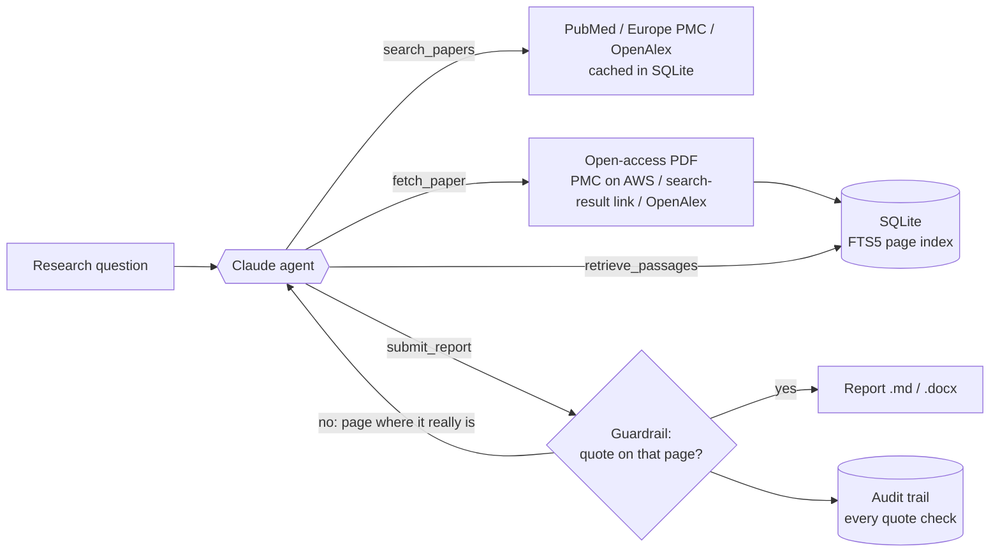

# Technical details

The [README](../README.md) explains what the tool does and why. This page is for developers: how the
pieces fit, the design decisions, and how to run and deploy it.

## Architecture



1. **Agent.** Claude splits the question into sub-topics, picks the database (PubMed for recent
   systematic reviews and meta-analyses on health questions, Europe PMC for medicine and life sciences,
   OpenAlex for every other field), writes English search queries (also for Hebrew questions), reads
   abstracts and picks papers. If a PDF cannot be downloaded it chooses another paper.
2. **Retrieval.** Each PDF page is stored in a SQLite FTS5 table; the agent reads only the pages that
   BM25 ranks as relevant.
3. **Generation.** Findings, caveats and 1-3 exact quotes per paper, with page numbers.
4. **Guardrail.** Every quote is normalized and must appear on the cited page. Failures go back to the
   agent once, with the page where the sentence really is; the final report is re-checked against the
   PDFs and keeps verified quotes only.
5. **Audit trail.** Every quote check, the model, the PDF's SHA-256 and the run cost are stored in SQLite.

## The quote guardrail

| Ignored (layout noise) | Kept (meaning) |
|---|---|
| case, spaces, line breaks, hyphenation, punctuation, ligatures (`fi` → `fi`), dash variants | every word in any script, every digit, the decimal point (`1.1` ≠ `11`), minus signs, `<` `>` `≤` `≥` `%`, the page number |

`p>0.05` instead of `p<0.05`, one changed number, or a correct sentence on the wrong page are all
rejected. Quotes shorter than 20 normalized characters are rejected as too unspecific to prove anything.

## The number guardrail

Findings are the model's own words, so they cannot be matched as text, but the numbers in them can.
Every number in a paper's findings (effect sizes, confidence limits, percentages, sample sizes) is
looked up among the numbers printed in that paper; a rounded value counts (0.72 for a printed 0.719).
Every number in the conclusion must appear in a verified finding or quote, so a number cannot pass just
because it happens to be printed somewhere in some paper. Numbers that are not found go back to the
agent like rejected quotes, and any that remain are marked ⚠️ in the report. Not checked: wording,
context, and the sign of a value.

## Code map

```text
src/verified_lit_review/
  agent.py                 Claude tool-use loop, guardrail feedback, cost tracking
  prompts/agent_system.md  the execution prompt (kept separate from code)
  build_report.py          quote normalization + the verified Markdown report
  numbers.py               number guardrail
  sources.py               PubMed, Europe PMC and OpenAlex clients (rate limit, back-off, offline cache)
  fetch.py                 open-access PDF download + page indexing
  db.py                    SQLite: search cache, papers, FTS5 page index, runs, quote checks
  service.py               shared entry point for the web UI and the API; background runs for the web UI
  api.py                   FastAPI REST API
  md_to_docx.py            Markdown → Word, right-to-left Hebrew aware
app.py                     Streamlit web UI (Hebrew, right-to-left)
tests/                     83 tests; none calls the model or the network
```

## Design decisions

- **Three open databases, chosen per question.** PubMed (restricted to systematic reviews and
  meta-analyses from the last 10 years, with free full text) so the newest syntheses are not missed;
  Europe PMC for biomedicine; OpenAlex for every discipline. The agent decides, and falls back to
  another when results are thin.
- **Journal sources, filtered in code where the APIs allow it.** OpenAlex: journal articles and
  reviews, not retracted, in CWTS "core" journals (leaves out marginal and predatory venues). Europe PMC:
  no preprints, no retracted publications. PubMed: systematic reviews and meta-analyses, not retracted.
  These filters do not exclude every editorial or letter, so the prompt also tells the agent to reject
  non-research items; that part is the model's judgement, not a guarantee.
- **The guardrail lives in code, not in the prompt.** The prompt asks for exact quotes; the code checks them.
- **A manual tool-use loop** instead of a framework, so every step is visible, testable and logged.
- **Prompt caching.** Each agent turn re-sends the conversation; caching the prefix cut one run from
  $0.83 to $0.31.
- **Official APIs only, politely.** No scraping. An honest User-Agent, at most one request per second
  per host, exponential back-off that honours `Retry-After`, and a SQLite cache, so a repeated question
  makes no network calls and still works offline.
- **Defence in depth for a public demo.** Daily run limit, a per-run cost cap (`MAX_COST_PER_RUN`,
  default $1), optional password with an attempt limit, question length limit, the API off unless
  `API_TOKEN` is set, PDF downloads refused for private/internal addresses (SSRF) and capped at 40 MB
  while streaming, and document text passed to the model labelled as untrusted data (prompt-injection hygiene).
- **Runs survive a dropped connection.** A review takes minutes; in the web UI it runs in a background
  thread whose token is kept in the page URL, so a phone that locks its screen or a page refresh finds
  the same run again instead of losing a paid report.
- **Tests never call the model.** A scripted fake model drives the agent loop, so CI is free and deterministic.

## Run it

```bash
pip install -r requirements.txt
export ANTHROPIC_API_KEY=...          # never commit it; .env and *.db are git-ignored

python -m verified_lit_review "Does telephone follow-up after discharge reduce readmissions?" --n 3   # CLI
streamlit run app.py                                                                                 # web UI
uvicorn verified_lit_review.api:app --app-dir src                                                    # REST API, docs at /docs
python -m pytest                                                                                     # tests, no key needed
```

On Windows PowerShell use `$env:ANTHROPIC_API_KEY = "..."`; for the CLI and API set `PYTHONPATH=src`
or `pip install -e .`.

### REST API

| Method | Path | |
|---|---|---|
| `POST` | `/reviews` | `{"question": "...", "n_papers": 3, "language": "he"}` → report Markdown, verified and rejected quotes, cost |
| `GET` | `/runs` | recent runs with verification counts |
| `GET` | `/runs/{id}` | one run with its full audit trail |

### Cloud (Streamlit Community Cloud)

Deploy `app.py` from this repo and paste the keys from
[`.streamlit/secrets.toml.example`](../.streamlit/secrets.toml.example) into the app's *Secrets*; the key
never enters the repository. Every run is paid for with the owner's API key, so the hosted app gives
each visitor one trial run (`RUNS_PER_VISITOR`, or an `APP_PASSWORD` instead), shows saved example
reports for free, and enforces a `DAILY_RUN_LIMIT` (default 10 per 24 h) and `MAX_PAPERS` (default 5).
The per-visitor limit lives in the browser session and the daily counter in a local SQLite file, so
neither is a hard guarantee (an app restart resets them); the hard ceiling is the prepaid API credit,
with auto-reload off.

## Example run log

Question: *Does telephone follow-up after hospital discharge reduce readmissions?*
([full log](../examples/telephone-follow-up/run_log.txt)). Abridged; the full run took about 6 minutes:

```text
🔍 [europepmc] 'post-discharge telephone call readmission randomized': 4 papers
🔍 [openalex] 'telephone follow-up discharge readmissions': 10 papers
⬇  10.1093/ageing/afaa002: ok, 12 pages
⬇  10.1089/pop.2009.0076: failed            (no open PDF -> the agent picks another paper)
⬇  10.1186/s12913-021-06156-2: ok, 12 pages
✅ submission 1: 7/7 quotes verified
💲 74,232 input (50,035 from cache) + 5,011 output tokens ≈ $0.24
```

## Lessons learned

- **Normalization is a safety decision.** A first version stripped everything except Latin letters and
  digits, so `p<0.05` matched `p>0.05` and Hebrew quotes could never verify. A code review caught it.
- **Verification must be per page**, not per document, or a correct sentence with a wrong page number passes.
- **Read the API's real behaviour.** Europe PMC answers `sort=RELEVANCE` with HTTP 503, which looked like
  an outage; the default order is already relevance.
- **Publisher sites block scripts even for open papers.** The PMC open-data bucket on AWS is the reliable route.
- **Review your own work adversarially.** Review passes (QA, security, interviewer) found real bugs:
  two DOIs mapping to one file name, a failed PMC lookup skipping the other download routes, an API with
  no authentication, conclusion numbers that could pass by chance. All fixed with tests.
- **A long run needs to outlive the page.** On a phone, a run that belonged to the page was lost when
  the connection dropped; it now runs in the background.
